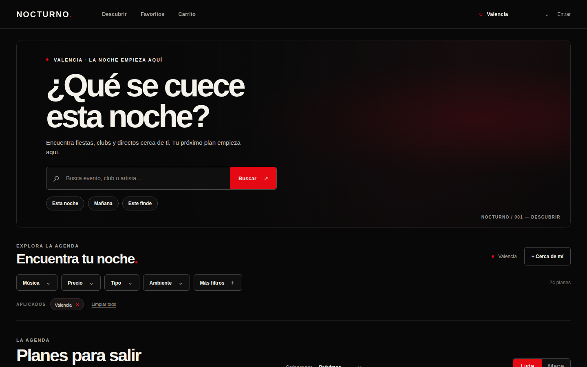
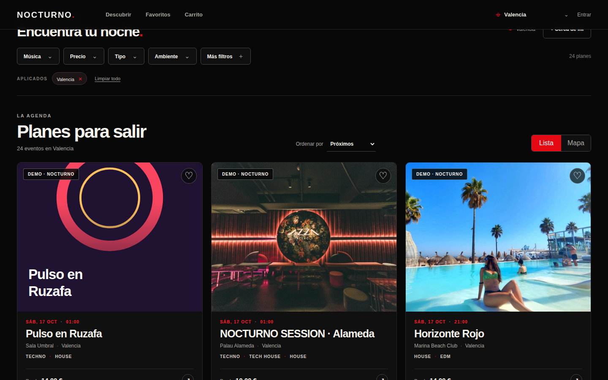
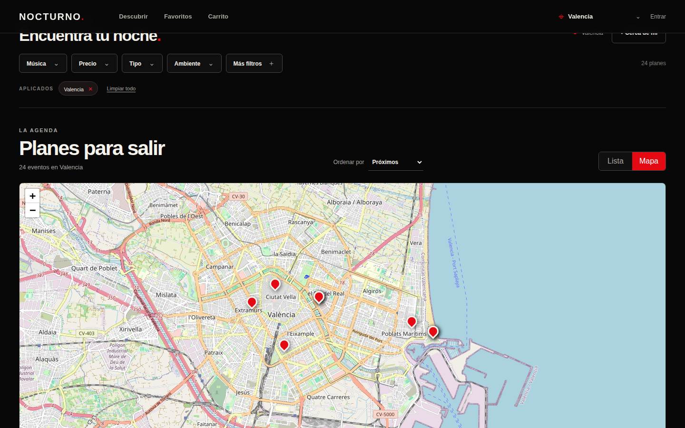
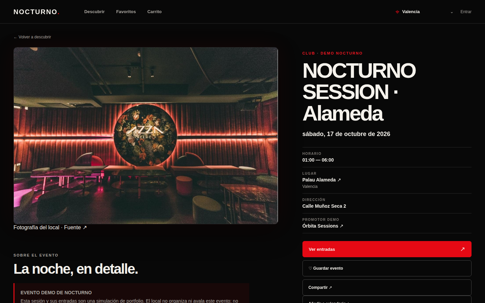
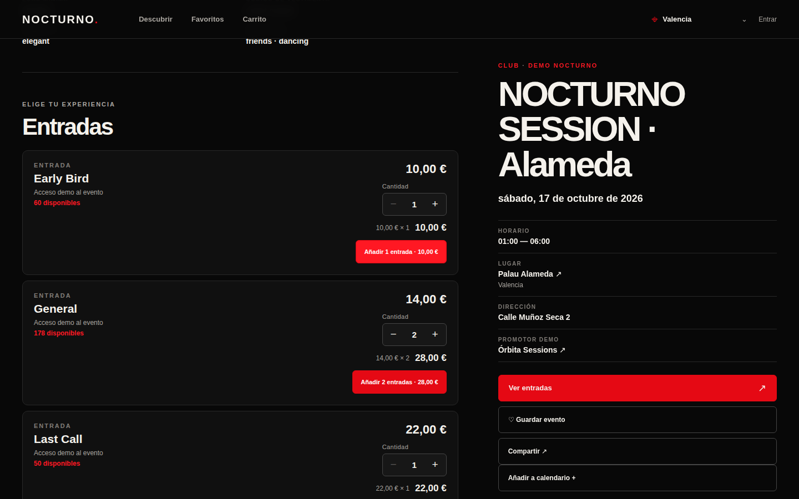
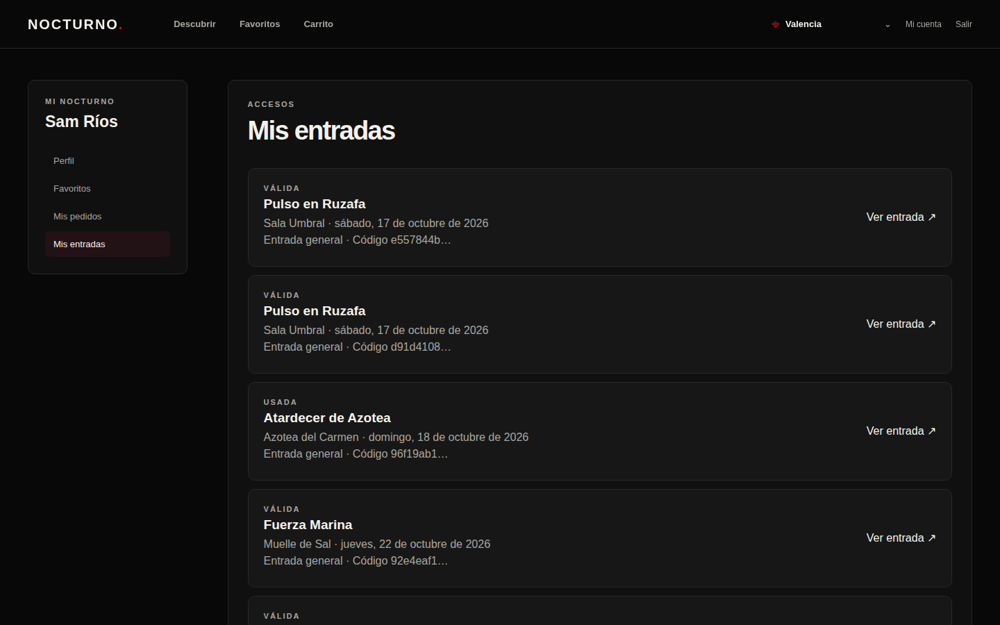
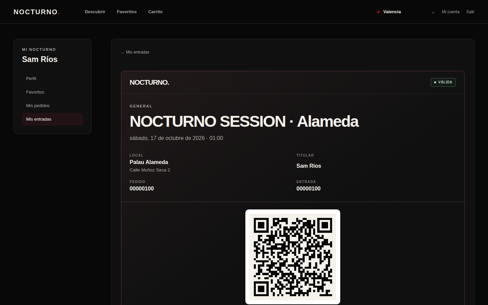
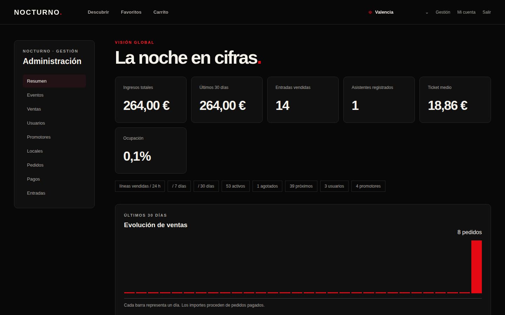
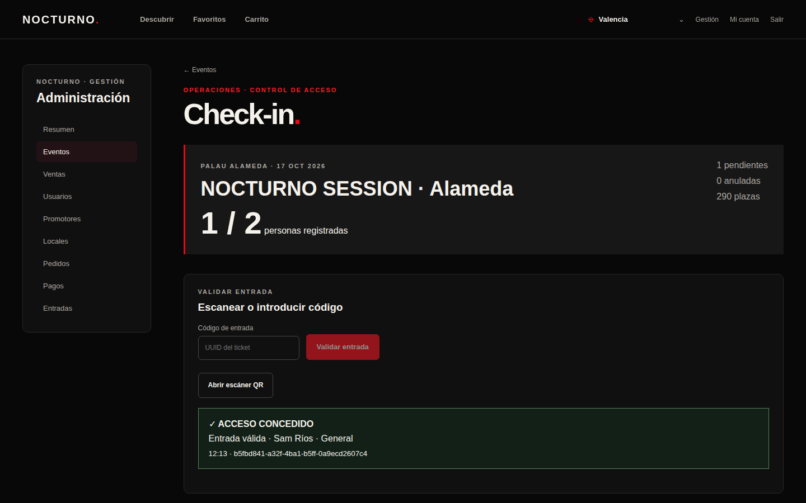
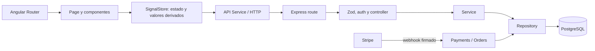

# NOCTURNO.

**Nightlife discovery, ticketing and event operations platform.** Explora eventos por ubicación, música, fecha y precio; gestiona el recorrido de compra, los pedidos y el acceso desde un mismo producto.

     

[](https://github.com/LucaMZM/nocturno/actions/workflows/ci.yml) 

[Capturas](#capturas) · [API local](#api-y-pruebas) · [Fuentes de la demo](docs/demo-sources.md)

**Proyecto independiente de portfolio.** Los datos de algunos locales proceden de fuentes públicas; los eventos, precios y entradas de Nocturno son simulaciones. No existe afiliación ni venta oficial para esos locales. No hay una demo desplegada ni una API pública.

## Problema y solución

Quien busca una sesión necesita conocer local, ubicación y disponibilidad; quien la organiza necesita vender, consultar ventas y validar accesos sin perder el historial. Nocturno une ambos recorridos sobre datos de PostgreSQL.

## Capturas

<p align="center"></p>

| Discover | Mapa |
| :---: | :---: |
|  |  |

| Detalle del evento | Selección de entradas |
| :---: | :---: |
|  |  |

| Mis entradas | QR individual |
| :---: | :---: |
|  |  |

| Dashboard | Check-in |
| :---: | :---: |
|  |  |

El [carrito con dos entradas](docs/screenshots/06-cart.png) completa el recorrido visual. Todas las capturas proceden de la aplicación levantada con el seed en un runner aislado de GitHub Actions. El código del QR mostrado se invalidó mediante check-in antes de publicar la imagen. [Proceso y archivos](docs/screenshots/README.md).

## Funcionalidades

| Área | Funciones implementadas |
| --- | --- |
| Descubrimiento | Home/Discover, búsqueda, filtros combinables y reproducibles por URL, lista/mapa, ciudad manual, «Cerca de mí», radio, distancia y fichas públicas de eventos, locales y promotores. |
| Entradas | Tipos y stock, carrito persistido, checkout, pedidos, pagos, QR, check-in, lista de espera, calendario `.ics` y compartir evento. El refund completo está implementado y pendiente de prueba real con Stripe test. |
| Cuenta | Registro, login, favoritos, perfil, pedidos y entradas propias. |
| Promotor | Dashboard limitado a sus eventos, tipos de entrada, ventas, asistentes y check-in. |
| Administración | Métricas globales, usuarios, promotores, locales, eventos, pedidos, pagos y entradas; vistas Todos, Activos, Inactivos y Borrados. |

## Arranque local

Requiere Node `^24.15.0` o `>=26`, npm y PostgreSQL. Crea una base local y un usuario con permisos sobre ella. El ejemplo de `DATABASE_URL` presupone `nocturno`/`nocturno`; ajústalo a tu instalación.

```bash
cd backend
cp .env.example .env
# Edita DATABASE_URL y genera dos secretos JWT diferentes de al menos 32 caracteres.
npm ci
npm run db:migrate
npm run db:seed
npm run dev
```

En otra terminal:

```bash
cd frontend
npm ci
npm start
```

Abre `http://localhost:4200`. Angular reenvía `/api` al backend; `http://localhost:3000/health` confirma que está vivo. Swagger está en `http://localhost:3000/api/docs`. `db:migrate` aplica incrementalmente las migraciones 001–011 y registra las ya aplicadas. `db:reset` **borra datos**; úsalo solo si quieres una base nueva.

## Roles y demo

El seed solo se permite fuera de producción. `npm run db:seed` usa UUID fijos y evita duplicados. El catálogo actual contiene **20 locales reales documentados** y **9 locales ficticios para pruebas internas**, con **56 eventos demo de Nocturno** y **22 fichas históricas externas inactivas**: 29 locales y 78 registros de evento en total. Los eventos demo se distribuyen principalmente entre Valencia, Madrid y Barcelona; sus fechas futuras se calculan al ejecutar el seed. Incluye pedidos, pagos y entradas simulados para poblar el dashboard, sin representar cobros reales de Stripe. Las fuentes y condiciones de uso de imágenes externas están en [fuentes de la demo](docs/demo-sources.md). Los 21 SVG locales pertenecen a fixtures ficticios; un nuevo seed no reactiva eventos borrados.

Estas son las cuentas de desarrollo:

| Rol | Correo | Contraseña de desarrollo |
| --- | --- | --- |
| Admin | `admin@nocturno.test` | `AdminDemo!2026` |
| Promotor | `promoter@nocturno.test` | `PromoterDemo!2026` |
| Usuario | `user@nocturno.test` | `UserDemo!2026` |

`USER` descubre, guarda favoritos, compra y consulta sus pedidos y entradas. `PROMOTER` gestiona sus eventos, tipos de entrada, ventas, asistentes y perfil. `ADMIN` gestiona todos los recursos y consulta métricas globales. El backend valida estos permisos además de los guards de Angular.

## Arquitectura



| Capa | Tecnologías del proyecto |
| --- | --- |
| Frontend | Angular 22, TypeScript 6, Router, Reactive Forms, `@ngrx/signals`, RxJS y Leaflet/OpenStreetMap. |
| API | Node.js, Express 5, Zod, JWT con `jose`, Helmet, CORS, `pg` y Swagger/OpenAPI. |
| Datos | PostgreSQL 17, migraciones SQL incrementales y consultas parametrizadas, sin ORM. |
| Pagos | API de Stripe para PaymentIntent y webhook firmado; falta la prueba E2E con cuenta Stripe test. |
| Pruebas | `node --test` para backend y contratos/lógica de frontend; build de Angular. |

El dominio relaciona `User`, `Promoter`, `Venue`, `Event`, `TicketType`, `Favorite`, `Cart`, `Order`, `OrderItem`, `Payment`, `Ticket` y `Waitlist`. Los `OrderItem` conservan snapshots del evento, local, fecha y precio. La propiedad del promotor se comprueba en backend. Los SignalStores centralizan estado, filtros y datos derivados; sus métodos asíncronos llaman a servicios HTTP de la aplicación.

Los eventos públicos se abren por slug; el panel edita por UUID. Al cambiar el título, el backend genera un slug nuevo y resuelve colisiones. Los filtros de Discover se abren en un modal central y viven en query params: admiten municipio, provincia, género, ambiente, tipo, vestimenta, estado público, fechas, precio, edad, texto, orden y página. Al aplicar un filtro se actualizan los resultados y la vista vuelve al inicio. El panel de gestión filtra eventos, ventas, usuarios, pedidos, pagos y entradas en el backend antes de paginar. El ADMIN distingue Todos, Activos, Inactivos y Borrados; «Todos» excluye la papelera. Borrar conserva `status`, pone `is_active = false` y registra `deleted_at`. Restaurar limpia `deleted_at`, mantiene el evento inactivo y exige una activación posterior independiente. La API rechaza reactivar un evento borrado y PostgreSQL aplica la misma regla.

La vista Mapa usa Leaflet y teselas OpenStreetMap. Los eventos, coordenadas y filtros proceden de la API propia; las teselas requieren Internet. Los eventos agotados admiten lista de espera para usuarios autenticados; la inscripción aún no envía correos. Los locales y promotores tienen fichas públicas. El historial de pedido usa snapshots de título, local, fecha y precio tomados al comprar.

**Cerca de mí** solicita permiso solo al pulsar el botón. La posición se mantiene en memoria del navegador y se envía al backend en la petición de eventos; no se guarda en PostgreSQL ni se escribe en la URL. El radio (2, 5, 10, 25 o 50 km) y el orden son visibles como filtros. El backend calcula `distanceKm` desde las coordenadas del local, filtra antes de paginar y devuelve la distancia para la tarjeta. Un municipio y un radio son filtros independientes. Si se bloquea la ubicación o agota el tiempo, se conserva la selección manual de ciudad. Ejemplo:

```text
GET /api/events?latitude=39.47&longitude=-0.37&radiusKm=10&sort=distance
```

**Recorrido de compra:** Discover → Event → Ticket Type → Cart → Checkout → Order → Ticket → QR → Check-in. El checkout reserva stock en una transacción. El servidor calcula importes en céntimos y crea un PaymentIntent de Stripe cuando está configurado para pedidos de pago. Solo el webhook firmado confirma el pago, mueve `reserved` a `sold` y emite un ticket individual por unidad. `payment_intent.payment_failed` marca el intento como fallido sin liberar inmediatamente la reserva para permitir reintentos; el vencimiento la libera. El ADMIN puede solicitar un refund completo de un pago Stripe real; solo el webhook firmado confirma el reembolso y actualiza pedido y entradas. Los pagos ficticios del seed no se envían a Stripe. El modelo v1 no representa reembolsos parciales. Los pedidos gratuitos emiten entradas directamente. Cada ticket tiene un código aleatorio representado como QR; el check-in protegido impide reutilizarlo. Consulta [flujo de Events](docs/frontend-events-flow.md), [autenticación](docs/auth-flow.md), [compra](docs/checkout-flow.md) y [estado de esta pasada](docs/portfolio-release.md).

## Seguridad

Zod valida entradas; las consultas SQL usan parámetros; JWT de acceso y refresh cookie `HttpOnly` protegen sesiones, mientras roles y propiedad de recursos se verifican en backend. Helmet aplica cabeceras y CORS limita orígenes. Precio y stock se comprueban en servidor; los webhooks requieren firma y se procesan de forma idempotente; el check-in bloquea el doble uso. PostgreSQL impone la regla de soft-delete. La posición del usuario no se guarda en PostgreSQL. Estas medidas no equivalen a una auditoría externa de seguridad. Para desplegar hay que usar HTTPS, secretos nuevos, CORS del dominio final y copias de seguridad; el seed demo no debe ejecutarse en producción.

## Variables de entorno y Stripe test

`backend/.env.example` documenta `DATABASE_URL`, `PORT`, `NODE_ENV`, `CORS_ORIGIN`, `FRONTEND_URL`, dos secretos JWT distintos y las tres variables Stripe opcionales. `.env.example` de la raíz contiene las variables para Docker Compose. Los archivos `.env` reales están ignorados por Git. No publiques secretos ni credenciales personales.

Rellena `STRIPE_SECRET_KEY`, `STRIPE_PUBLISHABLE_KEY` y `STRIPE_WEBHOOK_SECRET` en `backend/.env`; usa claves `sk_test_` durante desarrollo. Para recibir eventos locales, ejecuta Stripe CLI con `stripe listen --forward-to localhost:3000/api/stripe/webhook` y copia el secreto que muestra a `STRIPE_WEBHOOK_SECRET`. Reinicia el backend. La clave publicable llega a Angular desde `/api/config/payments`. El secreto nunca se envía al navegador. Sin estas tres variables, las compras de pago muestran que Stripe no está configurado; las entradas gratuitas funcionan. Las pruebas locales usan firmas HMAC de fixture para comprobar éxito, fallo, reembolso e idempotencia; no sustituyen una prueba real con la cuenta Stripe test.

## Docker

Docker Compose incluye PostgreSQL, backend y frontend Nginx con proxy `/api`. Copia `.env.example` a `.env` en la raíz y sustituye los dos secretos JWT por valores aleatorios. Luego:

```bash
docker compose up --build
```

La web queda en `http://localhost:4200` y la API en `http://localhost:3000`. El volumen `nocturno_pgdata` conserva los datos. Compose aplica migraciones y seed demo al arrancar en modo desarrollo. Para despliegue detrás de HTTPS, configura los orígenes permitidos y `NODE_ENV=production` para cookies Secure; no ejecutes seed demo en producción.

## API y pruebas

Con la API local en marcha: [Swagger UI](http://localhost:3000/api/docs), [OpenAPI JSON](http://localhost:3000/api/openapi.json) y [colección Postman](backend/Nocturno.postman_collection.json). No existe URL pública de API.

```bash
cd backend && npm test && npm run check
cd frontend && npm test && npm run build
```

Las pruebas backend que necesitan PostgreSQL se omiten si `DATABASE_URL` no está definida; con la configuración local ejercitan auth, refresh, control aislado de PROMOTER, stock concurrente, webhooks, geofiltros, lista de espera y ciclo de Events. [`.github/workflows/ci.yml`](.github/workflows/ci.yml) prepara PostgreSQL temporal, aplica migraciones y ejecuta ambas suites, el check de sintaxis y el build para `main`. El seed no es necesario en CI. Las respuestas de error usan `{ "error": { "code": "...", "message": "...", "details": null } }`. Los logs locales quedan en `backend/logs` y se ignoran por Git.

## Límites de V1

Las compras de pago y los refunds reales requieren claves Stripe test y un webhook accesible; los tests locales de firma e idempotencia no sustituyen una compra E2E. Geolocalización y cámara requieren permisos del navegador; en producción necesitan HTTPS. La lista de espera no envía correos. Las fotos externas de locales y las teselas de OpenStreetMap dependen de terceros. Las fichas históricas externas son informativas y quedan inactivas, fuera de Discover. Las pruebas frontend actuales verifican lógica y contratos en Node; no son una suite completa de componentes con DOM.

## Licencia

**Proprietary — All Rights Reserved.** El código está disponible para revisión y evaluación de portfolio. Consulta [LICENSE](LICENSE) para las condiciones de uso; los nombres e imágenes de terceros conservan sus propios derechos.

## Cookies y Yomogan

Preferencias de cookies como demostración visual y asesor de eventos con recuperación híbrida sobre PostgreSQL. Ollama local es el proveedor predeterminado; si falta, el chat identifica expresamente el modo búsqueda. El avatar oficial está integrado en el botón, cabecera y mensajes. [Arranque de Yomogan en Mac, configuración y límites](docs/cookies-yomogan.md#mac-local-pasos-para-ejecutar-tú).
