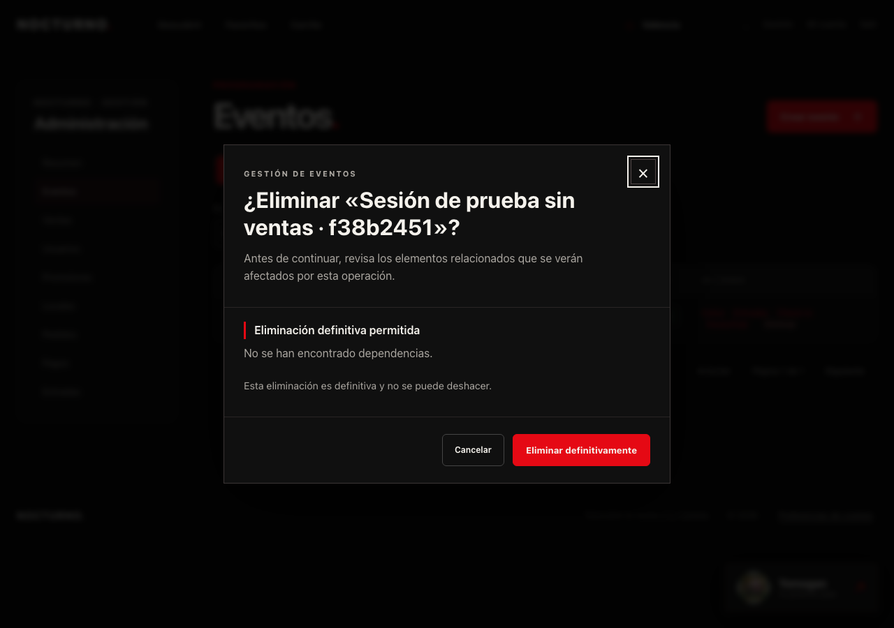
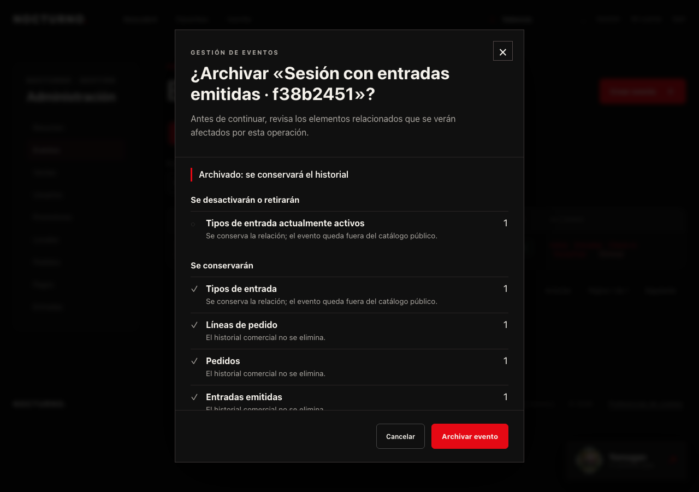

# Integridad referencial y eliminación con análisis de impacto

## Alcance y comprobación

Se conserva Express Route → Controller → Service → Repository → PostgreSQL y
Angular Page → componente visual → SignalStore → API Service. El flujo completo de
preview/modal/confirmación se aplica a Events, compartido por ADMIN y PROMOTER.
No se cambian cookies, pagos, proveedores de IA ni el significado de `status`.

Verificación realizada con PostgreSQL **18.6**, en un clúster temporal en un puerto
separado. No se han aplicado migraciones ni seed a la base local del usuario.
Docker no estaba disponible. No se ha hecho push ni modificado producción.

## Relaciones reales

| Padre | Dependencias | Política PostgreSQL existente |
| --- | --- | --- |
| Venue | Events | RESTRICT |
| Promoter | Events / Users.promoter_id | RESTRICT / SET NULL; la nueva política de servicio bloquea ambas relaciones |
| User | Orders / Tickets | RESTRICT |
| User | RefreshTokens / Cart / Favorites / Waitlist | CASCADE, solo si no hay historial que impida borrar el usuario |
| Event | OrderItems / Tickets | RESTRICT |
| Event | TicketTypes / Favorites / Waitlist / EventImages / YomoganEmbeddings | CASCADE físico; nunca representa un archivado |
| TicketType | OrderItems / Tickets | RESTRICT |
| TicketType | CartItems | CASCADE |
| Cart | CartItems | CASCADE |
| Order | OrderItems / Payment | RESTRICT |
| OrderItem | Tickets | RESTRICT |

PK y claves de dominio usan UUID. Favoritos, lista de espera, carrito por usuario,
claves de idempotencia, slugs y códigos QR tienen UNIQUE. Las claves ajenas conservan
ON UPDATE NO ACTION; no se cambian identificadores. El precio de TicketType sigue
NUMERIC(10,2); los snapshots, totales y pagos usan BIGINT en céntimos.
Los CHECK existentes impiden negativos, fechas invertidas y sold+reserved>quantity.

### Migraciones nuevas, sin reparar filas antiguas

- **012_integrity_constraints.sql**: claves compuestas para impedir que una línea
  combine Event y TicketType de eventos distintos, o que un Ticket difiera de su
  OrderItem en evento/tipo. CHECK del subtotal de línea = precio por cantidad;
  formato de moneda; índices de FK antes ausentes.
- Estas FK/CHECK se añaden **NOT VALID**: se comprueban nuevas escrituras, sin borrar
  ni corregir datos heredados. El auditor revisa también las filas antiguas. Tras
  revisar y remediar las incidencias con evidencia, se puede planificar una nueva
  migración `VALIDATE CONSTRAINT` para cada restricción. No se ha validado a ciegas.
- **013_event_deletion_audit.sql**: registra actor, rol, fecha, UUID del evento,
  operación, huella de análisis, requestId e impacto confirmado en la misma transacción.
  Actor y evento son identificadores históricos, deliberadamente sin FK: el registro
  de auditoría debe sobrevivir al borrado físico de ambos. No son permisos ni entidades
  huérfanas operativas. No se exponen conversaciones ni datos de compradores en el modal.

Referencia de [NOT VALID y VALIDATE CONSTRAINT en PostgreSQL 18](https://www.postgresql.org/docs/18/sql-altertable.html).

## Auditoría ejecutable (solo lectura)

Con DATABASE_URL configurada para la base que quieras inspeccionar:

```sh
cd backend
npm run db:audit
```

El script usa una transacción READ ONLY / REPEATABLE READ y un timeout de consulta.
Devuelve JSON con cada comprobación, cantidad, hasta 20 identificadores de muestra,
migraciones, columnas, índices y definiciones reales de constraints/FK. No imprime
contraseñas ni filas completas de usuarios. No corrige datos ni ejecuta DDL.

- Exit **0**: sin errores de integridad (puede haber advertencias).
- Exit **1**: inconsistencias importantes detectadas.
- Exit **2**: auditoría no ejecutable (conexión/esquema/consulta); mensaje sin secretos.

Comprueba vínculos cruzados, comprador de cada Ticket, aritmética de líneas y pedidos,
importe/moneda/estado de Payment, número de tickets por unidad comprada, estados y
fechas de uso, sold según pedidos PAID, reserved según AWAITING_PAYMENT, stock,
coordenadas, promotores sin perfil, carritos no disponibles, todas las FK declaradas
(incluidas las NOT VALID), y CHECK pendientes de validar. Un pedido gratuito PAID no
necesita Payment; un pago fallido puede mantener temporalmente su reserva vigente.
Un evento cancelado o archivado no invalida por sí solo un pedido histórico pagado.

### Hallazgo real en el seed

La auditoría completa del dataset de desarrollo encontró una entrada heredada USED
sin used_at: `90000000-0000-4000-8000-000000000003`.
El seed la inserta con estado USED sin aportar la fecha. El resto de checks no encontró
violaciones. No se ha inventado una fecha ni corregido el registro automáticamente.
Su remediación requiere recuperar una fecha de uso fiable o decidir explícitamente
cómo representar ese histórico desconocido; no es correcto poner NOW() y fingir que
es la fecha real. El auditor debe seguir señalándolo mientras no se resuelva.

## Política por entidad

| Entidad | Eliminación definitiva | Con dependencias importantes | Alternativa |
| --- | --- | --- | --- |
| Event | Sin líneas de pedido/tickets/pagos y con stock coherente | Archivado; incoherencia o ya archivado bloquea la operación | Restaurar desde Borrados como inactivo |
| Venue | Sin Events | 409 con número de eventos | Conservar local y gestionar sus eventos |
| Promoter | Sin Events ni Users asignados | 409 con recuentos; no desasigna usuarios silenciosamente | Gestionar relaciones antes de borrar |
| User | Sin Orders ni Tickets | 409 con recuentos | Desactivar mediante isActive |
| TicketType | Sin OrderItems/Tickets ni sold/reserved | 409 con recuentos | Desactivar mediante active |

Las cuatro políticas secundarias reutilizan sus rutas y servicios actuales, con
transacción y bloqueo del registro. Sus pantallas conservan las confirmaciones
existentes; el nuevo popup de impacto está integrado únicamente en Events. No se han
creado mecanismos de archivado de locales/promotores que el modelo no tenía.

## API de Events y confirmación

1. `GET /api/events/:id/deletion-impact` (ADMIN o PROMOTER propietario) es de solo lectura.
2. Devuelve `{data:{eventId,title,analysisToken,operation,recoverable,relations,blockers,warnings}}`.
   Cada relación tiene `{key,label,count,action,reason}`. Los recuentos son SQL reales;
   la huella incluye IDs y estado, no solo cantidades. Cambiar un favorito por otro
   con idéntico recuento también invalida la previsualización.
3. `POST /api/events/:id/deletion` valida con Zod
   `{analysisToken,operation:'delete'|'archive',requestId:UUID}`.
4. El servicio verifica permisos otra vez con el evento bloqueado, recalcula el
   impacto y compara la huella. `IMPACT_STALE` (409) exige actualizar el análisis;
   `EVENT_DELETION_BLOCKED` explica el bloqueo. Una decisión cliente no prevalece sobre SQL.
5. Transacción SERIALIZABLE, bloqueo de Event y TicketTypes, FK restrictivas y auditoría
   atómica. Conflictos serializables/deadlocks revierten y piden reanálisis, no se
   reintenta una eliminación obsoleta silenciosamente.
6. El mismo requestId/actor/evento/operación/análisis devuelve el resultado anterior.
   Las peticiones simultáneas no duplican acciones ni auditoría; otro payload con ese
   requestId obtiene conflicto. El frontend conserva requestId ante un error de red.

Swagger y Postman documentan ambos endpoints. El preview de Postman guarda los valores
para confirmar; un análisis blocked no se puede enviar como operación válida.

### Qué sucede al archivar

- Event.deleted_at=NOW(), is_active=FALSE, updated_at actualizado; status se conserva.
- Tipos actualmente activos se desactivan. La UI distingue su cantidad del total conservado.
- Se eliminan los elementos de carrito y embeddings derivados del evento.
- Favoritos, waitlist e imágenes se conservan, pero el evento ya no es público.
- Pedidos, pagos, tickets, snapshots, sold y reservas existentes no se destruyen ni se
  reembolsan. Las reservas ya emitidas siguen el flujo de pago/vencimiento existente.
- Nuevos carritos/checkouts adquieren bloqueo compartido sobre el evento y vuelven a
  leer disponibilidad: no pueden reservar después del archivado.
- Restaurar conserva el evento inactivo y los tipos desactivados. Activación de evento
  y de tipos de entrada son decisiones posteriores separadas. No se recuperan carritos
  descartados; las recomendaciones no reservan entradas.

Los endpoints heredados DELETE /events/:id y PATCH /events/:id/soft-delete conservan
**solo archivado**, con las mismas transacciones, comprobaciones y auditoría. No permiten
borrado físico ni cambiar la política; no reciben el token porque los clientes antiguos
no realizan preview. Solo en ese archivado heredado se reevalúan hasta tres veces
conflictos serializables transitorios; nunca se reintenta un borrado físico confirmado
con un token obsoleto. El dashboard usa exclusivamente el flujo nuevo con token.

Yomogan filtra publicación, is_active, deleted_at, fecha, tipo vendible y stock en SQL,
y vuelve a comprobarlos después de inferir. La escritura de caché también bloquea y
comprueba elegibilidad: un indexador que termine tarde no recrea embeddings archivados.
Restaurar/activar permite reindexar al consultar; borrar no llama a Ollama.

## Modal y pruebas

Diálogo nativo con estética Nocturno y datos del Store/API: carga, sin dependencias,
se eliminarán/desactivarán/conservarán, bloqueos, advertencias, obsolescencia, error,
ejecución y éxito. Gestiona foco, Tab, Escape, backdrop y scroll; no usa window.confirm.
Durante ejecución desactiva acciones/cierre y al terminar refresca la lista.

```sh
cd backend
npm test
npm run check
cd ../frontend
npm test
npm run build
# Playwright instalado como en el workflow existente, API+frontend y seed AISLADOS:
node tools/test-event-deletion-ui.mjs
```

El E2E solo se debe usar con una base de desarrollo temporal: crea Events de prueba,
una compra gratuita y conserva ese histórico hasta que termine el clúster temporal.
Prueba preview/cancelación/foco, error y reintento, huella obsoleta real, borrado,
archivo con entrada emitida, actualización de lista y 390/768/1280 px.
Capturas en `docs/screenshots/integrity/`. Los proveedores IA no se llaman en esta pasada.

### Resultado de esta pasada

- PostgreSQL 18.6: migraciones 001–013 aplicadas únicamente en bases temporales.
- Backend: **48/48** tests, sin skips; check de sintaxis correcto.
- Frontend: **32/32** tests; build de producción correcto.
- Auditoría completa: **49 comprobaciones**, metadatos reales de 235 constraints y
  62 índices en PostgreSQL 18. Base temporal limpia: exit0, sin incidencias.
  Seed temporal: exit1 por la entrada USED sin fecha indicada arriba, sin otras incidencias.
- Playwright headless con perfil aislado: recorridos de borrado/archivo, error/reintento,
  cambio real de dependencias, foco/Tab/Escape y 390/768/1280 px correctos. No se abrió
  un navegador personal. Las capturas son reales de ese build y del dataset temporal.
- El build mantiene avisos anteriores: CSS Yomogan, dependencias CommonJS y optional
  chaining de Payments. No se amplió el alcance para cambiarlos.
- CI preparado para ejecutar auditoría y E2E nuevos en la próxima publicación autorizada.
  No se ha hecho push ni ejecutado GitHub Actions para este commit local.

| Borrado sin historial | Archivado con entrada emitida |
| --- | --- |
|  |  |

[Modal a 390 px, con acciones visibles](screenshots/integrity/03-archive-impact-mobile.png).
